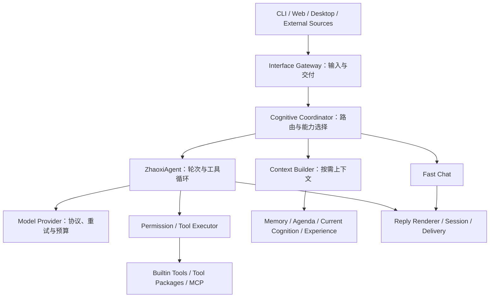

# 当前架构

更新：2026-10-05，源码版本 v1.4.7。本文按当前代码说明责任边界，版本实现过程见各版本开发记录。

## 主要调用链

`bootstrap/runtime.py::build_agent()` 是应用装配入口，由 models、knowledge、tools、storage、cognition、proactive 分模块创建服务。接口适配层负责输入和交付，核心负责一轮执行，Tool SDK 与外部来源插件提供扩展边界。

## 共享状态与轮次状态

`core/runtime.py::AgentRuntime` 集中声明应用共享服务，包括认知、记忆、会话、决策、内部活动、表情和备份。`ZhaoxiAgent` 创建 Runtime，bootstrap 填入服务；`RuntimeService` 让现有 `agent.agenda` 等属性读写转发到 `agent.runtime.agenda`，不存在两份服务状态。

Provider、工具注册表、ContextBuilder、执行器及已有 Planner / Workflow 等构造依赖仍由 Agent 持有；轮次预算、回复恢复和权限续跑逻辑仍在核心。Runtime 是明确共享服务的第一步，尚未完成所有服务消费者的迁移，也没有自动管理服务生命周期。

## 存储边界

- Memory 管长期记忆、索引与检索；Agenda 管行动事项；Current Cognition 管近期认知。
- Experience Stream 管统一经历与证据；Session 管会话和回复恢复；Perception 管外部观察及交互账本。
- Decision 的选择历史、用户准则、日记和回访保持各自语义，内部活动负责后台调度。
- 存储路径由 Settings 注入，备份使用同一份 DataStoreSpec。Experience 路径和模型开关文件本轮补齐为显式配置。

目录与数据库的默认值以 `config/settings.py` 为准。测试共享 fixture 将运行时路径移到临时目录，真实业务数据不承担测试夹具的角色。

## Web 模块

| 模块 | 职责 |
| --- | --- |
| `schemas.py` | 请求与响应模型 |
| `runtime.py` | 外部来源装配、后台任务、启动与关闭 |
| `settings_api.py` | 思考、界面与文件访问设置 |
| `perception_api.py` | 感知调试与外部来源控制 |
| `emoji_api.py` | 表情注册表、图片与模型调试 |
| `memory_api.py` | 记忆检索、簇与数据库维护诊断 |
| `dashboard.py` / `decision_learning.py` | 管理页与判断成长 API |
| `app.py` | 应用组装、鉴权、聊天/权限/会话、其余诊断与语音 |

路由工厂显式接收它们所需的服务。生命周期由 Web 持有的 `TaskSupervisor` 负责，诊断继续读取同一个 supervisor。所有路由仍经过原应用的鉴权中间件。

前端使用无构建步骤的静态脚本。`reply-renderer.js` 处理回复分段、分组、恢复和显示节奏，在 `shell.js` 前加载；DOM 气泡创建和页面事件仍由 shell 提供。Node 行为测试直接加载整个回复模块。

## 后续维护重点

架构的基本分层已存在，主要压力来自跨模块共享状态和入口文件持续增大。此次优先建立可审计的状态位置与测试边界。后续按需求逐步迁移 Runtime 消费者、拆出剩余诊断/语音路由，并将核心长循环拆成清晰的执行阶段；每一步保留权限、预算、工具完成后恢复和交付语义的回归覆盖。
